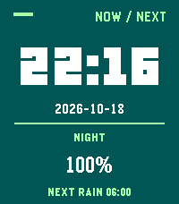

# Now / Next

[Get Now / Next on RePebble](https://apps.repebble.com/68afcbcc6c18416c98b6a1b7) · Pebble Time 2 · Version 0.1.0



A Pebble Time 2 face with a large clock and one changing context field. Morning, daytime, evening, and night each have a configurable start hour and field choice: rain chance, temperature, sunset, or watch battery. The footer previews the next field and its start time.

Settings provide independent background, digit, and accent colors. The date can be hidden or shown as YYYY-MM-DD, MM/DD/YYYY, or DD/MM/YYYY. The clock follows the watch's 12/24-hour setting.

Weather comes from Open-Meteo through the phone and refreshes every 30 minutes. If location, network, or valid data is unavailable, the affected field displays `UNAVAILABLE`. Weather values expire after one hour.

## Build

```bash
cd /Users/danielbally/Git/now-next/watchface
npm ci
cd /Users/danielbally/Git/now-next
python3 execution/verify_watchface.py
```

The build artifact is `watchface/build/watchface.pbw`. To inspect it in the emulator, install with `pebble install --emulator emery watchface/build/watchface.pbw` from the project root and take a screenshot with `pebble screenshot --emulator emery --no-open`.

See `directives/build_watchface.md` for the validation contract and `knowledge/procedural/build_and_check.md` for capture behavior.

The GIF-first store media and release commands are documented in `knowledge/procedural/publish_watchface.md`.
